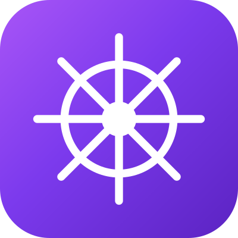

<p align="center">
  
</p>

<h1 align="center">Pilot MCP</h1>

<p align="center">
  Your ad accounts inside Claude, ChatGPT, Cursor and any MCP client.<br>
  Google Ads, Meta Ads, TikTok Ads, LinkedIn Ads, GA4, Search Console and more, plus Pilot's own analyses.
</p>

<p align="center">
  <a href="https://pilot.braike.com/en/pilot-mcp">Website</a> ·
  <a href="https://pilot.braike.com/en/docs/cli">Documentation</a> ·
  <a href="https://pilot.braike.com/en/pilot-mcp/skills">Skills</a> ·
  <a href="https://pilot.braike.com/en/confidentialite">Privacy</a> ·
  <a href="https://pilot.braike.com/en/cgu">Terms</a>
</p>

---

Pilot MCP is the hosted MCP server of [Pilot](https://pilot.braike.com), the paid-media copilot built by [Braike](https://braike.com). It connects your AI assistant to the ad platforms and measurement tools of your Pilot workspace. Your assistant reads your campaigns, spend and results, gets Pilot's analyses computed on the data Pilot collects every night, and, on the paid plan, changes campaigns when you ask.

This repository holds the public connection files, the 167 Pilot skills and the listing metadata. The server itself is a hosted service; there is nothing to build or run locally.

```
https://app.pilot.braike.com/mcp
```

| | |
| --- | --- |
| Transport | Streamable HTTP |
| Authentication | OAuth 2.1 with PKCE and dynamic client registration. No key to copy. |
| Registry name | `com.braike/pilot` in the [official MCP Registry](https://registry.modelcontextprotocol.io) |
| CLI | [`@braike/pilot`](https://www.npmjs.com/package/@braike/pilot) on npm |

## What it covers

**16 ad platforms**: Google Ads, Meta Ads, TikTok Ads, LinkedIn Ads, Microsoft Advertising, Pinterest Ads, Snapchat Ads, Amazon Ads, Apple Ads, Reddit Ads, Spotify Ads, Uber Ads, OpenAI Ads, Display & Video 360, Search Ads 360, Campaign Manager 360.

**Measurement**: Google Analytics 4, Google Search Console, Google Tag Manager, Google Merchant Center, Google Business Profile.

**Your tools**: Semrush, DataForSEO, Salesforce, Sellsy, WordPress, Magento, PBS Media Manager.

**Pilot's analyses**, built from data collected once a day:

- `pilot_cross_platform_overview`: all ad platforms together, ratios recomputed on the totals.
- `pilot_diagnose_wasted_spend`: what spends without converting.
- `pilot_budget_pacing`: campaigns that hit their cap and campaigns that underdeliver.
- `pilot_account_concentration`: how many campaigns carry 80% of the spend.
- `pilot_data_freshness`: how recent the figures are, and why one is missing.
- `pilot_sentinel_alerts`: broken tracking, disconnected accounts, stopped campaigns, with the money at stake.
- `pilot_get_objectives`: the client's targets (ROAS, CPA, volume) and actual progress.

## Plans

| | Free | Pilot MCP |
| --- | --- | --- |
| Price | €0, no time limit, no credit card | €29 per person per month excl. VAT, or €290 per year |
| Ad accounts | 1, on the platform of your choice | All of them, on all 16 platforms |
| Measurement tools, your tools, analyses, 167 skills | Included | Included |
| What the assistant can do | Read | Read, create, edit, pause, and delete one item at a time |

Prices as published on [pilot.braike.com](https://pilot.braike.com/en/pilot-mcp) on October 21, 2026. Rate limit: 60 calls per minute per plan, plus a monthly cap. To work as a team with approvals, see full Pilot.

## Connect your assistant

### ChatGPT

Pilot is in ChatGPT's plugin directory: [open the listing](https://chatgpt.com/plugins/plugin_asdk_app_6ad7518d3a808191aa5b92ab27901ba2), or search for Pilot in Plugins.

### Claude (claude.ai and Claude Desktop)

Customize, Connectors, Add, Add custom connector, then paste `https://app.pilot.braike.com/mcp`. Claude opens Pilot's sign-in on first use.

### Claude Code

```bash
claude mcp add --transport http --scope user pilot https://app.pilot.braike.com/mcp
```

Then run `/mcp` to sign in. Or install this repository as a plugin, which also brings the 167 skills:

```bash
/plugin marketplace add BRAIKERS/pilot-mcp
/plugin install pilot@braike
```

### Cursor, VS Code, Windsurf, Codex, Gemini CLI

One command registers Pilot in every assistant found on your computer:

```bash
npx @braike/pilot setup
```

Or add it by hand:

| Assistant | File | Entry |
| --- | --- | --- |
| Cursor | `~/.cursor/mcp.json` | `"pilot": { "url": "https://app.pilot.braike.com/mcp" }` under `mcpServers` |
| VS Code | user `mcp.json` | `"pilot": { "type": "http", "url": "https://app.pilot.braike.com/mcp" }` under `servers` |
| Windsurf (Devin Desktop) | `~/.config/devin/mcp_config.json` | `"pilot": { "serverUrl": "https://app.pilot.braike.com/mcp" }` under `mcpServers` |
| Codex | `~/.codex/config.toml` | `[mcp_servers.pilot]` then `url = "https://app.pilot.braike.com/mcp"` |
| Gemini CLI | `~/.gemini/settings.json` | `"pilot": { "httpUrl": "https://app.pilot.braike.com/mcp" }` under `mcpServers` |

For Gemini CLI, this repository is also an extension:

```bash
gemini extensions install https://github.com/BRAIKERS/pilot-mcp
```

### Clients that only start local programs

The CLI ships a stdio bridge to the remote server:

```json
{
  "mcpServers": {
    "pilot": { "command": "npx", "args": ["-y", "@braike/pilot", "mcp"] }
  }
}
```

Sign in once with `npx @braike/pilot login`. Details in the [CLI documentation](https://pilot.braike.com/en/docs/cli).

## Try it

Once connected, ask:

- "Compare last week's spend and conversions across Google Ads, Meta and TikTok."
- "Which campaigns spent money without any conversion in the last 30 days?"
- "Is my Google Ads budget on track for this month's target?"
- "Audit my Google Ads account for the last 30 days."

## Skills

The [`skills/`](skills) folder holds the 167 Pilot skills: audits, reports, diagnoses and campaign changes, each written for the Pilot MCP tools. Each one declares in its front matter the tools it calls and whether it writes (`pilot-mcp-read-only`). A skill that writes asks for confirmation before any change.

Install them with the CLI (`npx @braike/pilot skills install`), as a Claude Code plugin (above), or copy a folder into your assistant's skills directory. The catalogue with descriptions is on [pilot.braike.com/en/pilot-mcp/skills](https://pilot.braike.com/en/pilot-mcp/skills).

## Security and data

- Access is granted per workspace through OAuth, and your role in the workspace is checked again on every call.
- The assistant only reaches the accounts attached to your workspace, even when an agency's platform access covers more.
- Every change is read on the ad platform before and after, and recorded in the workspace's call log.
- Deletions target one item at a time, never in bulk.
- OAuth tokens of the ad platforms, billing and end-client files are never exposed as tools.
- You revoke the assistant's access at any time from your Pilot workspace.

Privacy policy: [pilot.braike.com/en/confidentialite](https://pilot.braike.com/en/confidentialite). Terms: [pilot.braike.com/en/cgu](https://pilot.braike.com/en/cgu).

## Repository contents

| Path | Purpose |
| --- | --- |
| `server.json` | Entry in the official MCP Registry |
| `.claude-plugin/`, `.mcp.json` | Claude Code plugin and marketplace |
| `gemini-extension.json` | Gemini CLI extension |
| `glama.json` | Glama listing ownership |
| `skills/` | The 167 Pilot skills |
| `assets/` | Logo |

## Pilot en français

Pilot MCP relie votre assistant IA (Claude, ChatGPT, Cursor, VS Code, Codex, Gemini CLI) aux régies publicitaires et aux outils de mesure de votre espace Pilot. Adresse du serveur : `https://app.pilot.braike.com/mcp`. Offre gratuite pour un compte publicitaire, sans limite de durée ; offre Pilot MCP à 29 € HT par personne et par mois. Présentation : [pilot.braike.com/pilot-mcp](https://pilot.braike.com/pilot-mcp).

## License

The files in this repository, skills included, are under the [MIT License](LICENSE). The Pilot service itself is governed by its [terms](https://pilot.braike.com/en/cgu).
